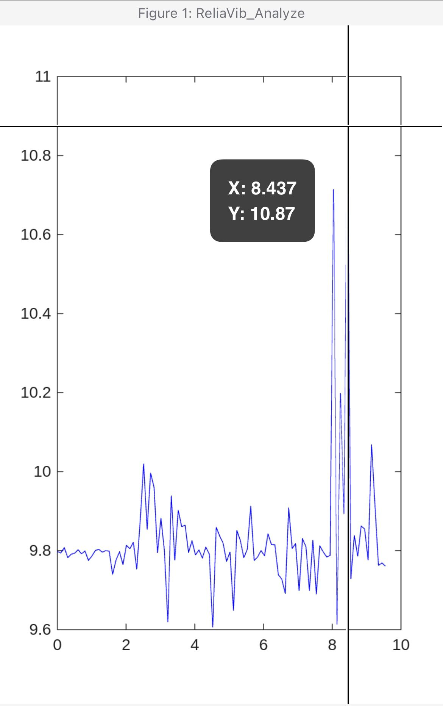

# ReliaVib

**Smartphone-based vibration analysis with MATLAB: a proof of concept for low-cost condition monitoring.**

ReliaVib explores a simple question: how far can a smartphone accelerometer go as a first screening tool for rotating equipment, before a dedicated vibration analyzer is brought in? The phone records acceleration through MATLAB Mobile; MATLAB on the desktop turns the recordings into time-domain plots and amplitude spectra.

The first test case is a domestic washing machine (AEG 6000 Series), measured at four points during a spin cycle. It is a controlled, repeatable source of rotating unbalance, chosen to validate the workflow before moving to industrial equipment.

## What is in the repository

| File | Purpose |
|---|---|
| `ReliaVib_Acquire.m` | Guides the user through four measurement points, records 10 s of acceleration at each one with MATLAB Mobile, shows a quick-look spectrum and saves one `.mat` file per point plus a CSV log |
| `ReliaVib_Analyze.m` | Loads every `ReliaVib_P*.mat` file in the folder, resamples the signal on a uniform time grid, removes the gravity component and saves a time-domain plot and a single-sided amplitude spectrum for each point |
| `ReliaVib_setup.jpg`, `ReliaVib_P1_example.jpg` | Screenshots from MATLAB Mobile: the four-point acquisition session and the raw time signal at point P1 |

## How to use it

1. Install MATLAB Mobile on the smartphone and sign in with the same MathWorks account used on the desktop.
2. Run `ReliaVib_Acquire.m` from MATLAB Mobile, place the phone on each point when prompted and press Enter to start each recording.
3. Make the saved `.mat` files available on the desktop, for example through MATLAB Drive.
4. Run `ReliaVib_Analyze.m` in the folder that contains the files. The plots are saved as PNG next to the data.

## Method and limits

A smartphone does not sample at a perfectly constant rate, so the analysis estimates the sampling frequency from the median time step and resamples the signal on a uniform grid before the FFT. The magnitude of the acceleration vector includes gravity, about 9.81 m/s², so the mean value is removed; otherwise the spectrum would be dominated by the 0 Hz component.

Typical smartphone accelerometers sample at about 100 Hz. By the Nyquist criterion the usable band is then limited to about 50 Hz. That covers the running speed of a washing machine drum or of many motors at low and medium speed, but not bearing defect frequencies, gear mesh or higher harmonics of a 2-pole motor. Coupling between phone and surface, sensor resolution and the lack of calibration also limit the results to comparative, qualitative screening. ReliaVib is not a replacement for a calibrated vibration analyzer or for evaluation against ISO 20816.

## Next steps

Alarm levels on RMS and peak values per measurement point; trend comparison between successive recordings of the same machine; a test on industrial rotating equipment with a reference measurement from a calibrated analyzer.

## References

ISO 20816-1, Mechanical vibration. Measurement and evaluation of machine vibration. Part 1: General guidelines (replaces ISO 10816-1).
C. M. Harris, A. G. Piersol, *Harris' Shock and Vibration Handbook*, McGraw-Hill.
MathWorks, [MATLAB Mobile documentation](https://www.mathworks.com/help/matlabmobile/).

## Author

Gianluigi Riccardi. [Website](https://gianluigiriccardi.github.io) · [LinkedIn](https://www.linkedin.com/in/gianluigi-riccardi-ai-industrial)

Released under the MIT License.
